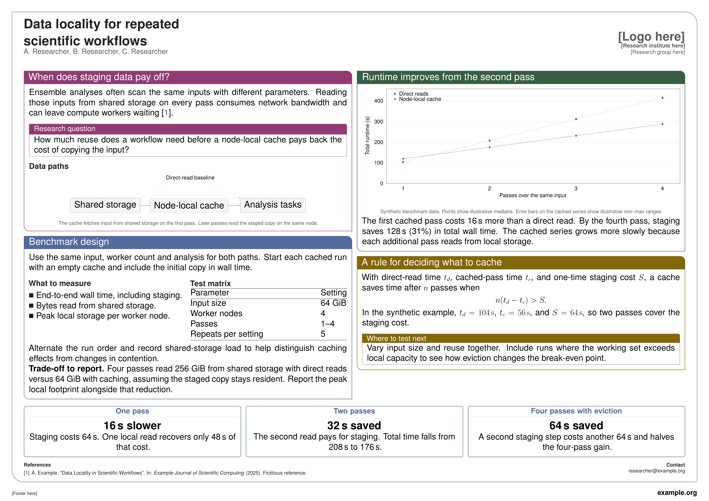

# Research poster template

LaTeX poster template with A0 landscape, A0 portrait, and custom page sizes.

<a href="template-preview.png">
  
</a>

## Build

Install LaTeX with `latexmk` and Biber. Run this from the repository root.

```sh
latexmk -pdf main.tex
```

Open `main.pdf`.

## Customize

- [main.tex](main.tex) has a **Poster settings** block for paper size, brand, layout mode, title, authors, and contact.
- [content.tex](content.tex) holds the poster sections. Edit the TikZ figures in [figures.tex](figures.tex) and the bibliography in [references.bib](references.bib).
- Select `template`, `kit`, or `hlrs` with `\useposterbrand`. Comment out the command for an unbranded poster. For a custom brand, copy [brands/template.tex](brands/template.tex) and select the copy by filename without the `.tex` extension.

## Layout

| Paper preset | Width × height |
|---|---|
| `a0-landscape` | 118.9 × 84.1 cm |
| `a0-portrait` | 84.1 × 118.9 cm |
| `conference-wide` | 140 × 90 cm |
| `open` | 118.9 cm wide, height follows content |

- Draft with `\posterpaper{open}`. Set a different working width with `\posterpaper[width=100cm]{open}`.
- Override dimensions with `\posterpaper[width=135cm,height=90cm]{conference-wide}`.
- Use `flow=canvas` for explicit rows or `flow=columns` for automatic columns on wide paper.
- Give each `posterrow` one relative weight per column, such as `{2,1}`. Use `\posterspacer` between stacked sections or rows.
- Adjust spacing with `\postersetup`. Common keys are `gap`, `gutter`, `padding`, `paragraph gap`, and `edge inset`.
- Check the PDF page count after changing the dimensions or content.

## License and credits

The LaTeX code, original sample figures, and generic text wordmark use the [MIT License](LICENSE). 
The layout is inspired by [KIT's poster templates](https://kit-cd.km.kit.edu/latex.php). 
The KIT and HLRS logos remain subject to their owners’ rights. This project is independent of both institutions.
